# MES research: when it moves, and which simple rules survive

Do not trade it, and do not change the live bot. `fh_15bp_1.5R` is the only rule that cleared the accounting gates. It made $1.07 per trade in train (715 trades, net $765.06), $12.95 in validation (171 trades, net $2,213.66), and $16.93 on the one holdout pass (135 trades, net $2,285.07, win rate 54.1%). The validation bootstrap p-value is 0.151 before the penalty and 1.000 after multiplying by the 63 tests. The cutoff written down before the run was an adjusted p-value of 0.10. A positive dollar total that does not clear that bar is not an edge. The train result is about one dollar a trade, which is smaller than one tick, and the later windows are a jump rather than the same result repeating.

This is a research note, not a recommendation to place a live order and not financial advice. The live bot's settings were not changed. The MNQ rerun of this same menu, the ES/NQ comparison, and the event-day tags are later in this note. They were not used to rewrite the MES result above.

## Costs, hours, and the Combine

TopstepX lists the Micro E-mini S&P 500 round turn at **$1.22** ($0.50 commission, $0.70 exchange, $0.02 NFA), read from https://help.topstep.com/en/articles/8284213-topstepx-commissions-and-fees on 2026-10-10. The October 2026 CME increase on that page is MCL and MNG, not MES. A market or stop order also pays 1 tick against the trader on the way in and, if it exits by stop or by a flatten, 1 tick on the way out. That is **$3.72** all-in for a market round turn on one MES. A limit that is filled only when price trades through it pays no entry slippage. The live config still says $1.40. This study does not edit that file.

The account rules used here are the 50K Combine: $3,000 profit target, $1,000 daily loss limit, $2,000 end-of-day trailing max loss, at most 50 MES, and flat by 3:10 PM CT. Passing also requires the best day to be under half of the profits. The later payout path uses 40% instead of 50%; that stricter test is reported beside the Combine result, and it is not what decides a pass. Size in this study risks $200 a trade, skips the trade if one contract cannot fit, takes at most two trades a day, and stops opening new trades once the day is down $400. MNQ and M2K were scored later, on their own files, with the same rule list and each contract's own dollars.

## The rules were written down first

The families, the parameter lists, the train/validation/holdout dates, and the pass rules live in `research/strategies.py`. The same text is saved to `docs/research/predeclared_grid.txt` at the start of the run, before the bars are scored. There are **63** eligible configurations and **66** rows once the three benchmarks are included. The 100 extra random seeds are a null distribution. They are not 100 more chances to crown a winner.

```text
Predeclared MES research grid. Written from research/strategies.py before any backtest result is used.

Splits: train is 2019-05-05 through 2023-12-31. Validation is 2024-01-01 through 2025-06-30. Holdout is 2025-07-01 through the end of the file. The holdout is scored only for rules that already qualified on train and validation, and it is not used to pick a replacement.

Costs: TopstepX MES round turn is $1.22 (commission $0.50 + exchange $0.70 + NFA $0.02). Market and stop orders pay 1 tick ($1.25) of adverse slippage per side. Limit orders pay none, and only if price trades through the limit. A market entry sized off a stop therefore includes 2 ticks plus the fee. A limit entry includes 1 tick (the stop or the flatten) plus the fee. The live bot's $1.40 placeholder is not changed.

Risk used only in this study: $200 per trade, at most 50 MES, at most 2 trades a day, no new trade after the day's closed P&L or worst mark is -$400 or worse, flat by 15:10 CT, one position at a time, cash session only. Overnight drift is described and not traded.

Selection, fixed before the run: train needs at least 100 trades, positive expectancy, and positive net. Validation needs at least 40 trades, positive expectancy, positive net, a win rate within 15 percentage points of train, and expectancy at least 25% of train. A neighbor is the same family with exactly one parameter changed to the next value on that parameter's list. If more than half of the existing neighbors have validation expectancy at or below zero, the rule is dropped. Remaining rules are ranked by validation expectancy times the square root of validation trades. Keep up to 3 with pairwise validation daily correlation under 0.5. Benchmarks cannot be finalists.

Multiple testing: N is the number of eligible configurations, not the benchmarks and not the 100 random seeds. Adjusted p = min(1, raw bootstrap p × N). The bootstrap resamples validation daily P&L 2000 times with seed 12345. A sign-flip check uses the same seed on its own generator. The random null uses seeds 1000 through 1099, train and validation only, and is not a menu to pick from. A finalist with adjusted bootstrap p above 0.10 is not a trading recommendation.

Combine, scored separately inside each split so later years do not leak backward: start $50,000, pass at +$3,000 if the best day is under half of profits, fail on a $1,000 intraday daily loss or an end-of-day trailing $2,000 max loss. The floor is min($50,000, high-water mark − $2,000) and only moves up. Attempts start on the first session of each month. Unfinished attempts count as not passed. The 40% consistency figure is the later payout path, not the Combine pass test.

Eligible configurations: 63. Total including 3 benchmarks: 66.

| name | family | parameters | eligible |
|---|---|---|---|
| orb_5_opposite_1R | orb | or_minutes=5, stop=opposite, target=1R | True |
| orb_5_opposite_2R | orb | or_minutes=5, stop=opposite, target=2R | True |
| orb_5_opposite_time | orb | or_minutes=5, stop=opposite, target=time | True |
| orb_5_mid_1R | orb | or_minutes=5, stop=mid, target=1R | True |
| orb_5_mid_2R | orb | or_minutes=5, stop=mid, target=2R | True |
| orb_5_mid_time | orb | or_minutes=5, stop=mid, target=time | True |
| orb_5_atr_1R | orb | or_minutes=5, stop=atr, target=1R | True |
| orb_5_atr_2R | orb | or_minutes=5, stop=atr, target=2R | True |
| orb_5_atr_time | orb | or_minutes=5, stop=atr, target=time | True |
| orb_15_opposite_1R | orb | or_minutes=15, stop=opposite, target=1R | True |
| orb_15_opposite_2R | orb | or_minutes=15, stop=opposite, target=2R | True |
| orb_15_opposite_time | orb | or_minutes=15, stop=opposite, target=time | True |
| orb_15_mid_1R | orb | or_minutes=15, stop=mid, target=1R | True |
| orb_15_mid_2R | orb | or_minutes=15, stop=mid, target=2R | True |
| orb_15_mid_time | orb | or_minutes=15, stop=mid, target=time | True |
| orb_15_atr_1R | orb | or_minutes=15, stop=atr, target=1R | True |
| orb_15_atr_2R | orb | or_minutes=15, stop=atr, target=2R | True |
| orb_15_atr_time | orb | or_minutes=15, stop=atr, target=time | True |
| orb_30_opposite_1R | orb | or_minutes=30, stop=opposite, target=1R | True |
| orb_30_opposite_2R | orb | or_minutes=30, stop=opposite, target=2R | True |
| orb_30_opposite_time | orb | or_minutes=30, stop=opposite, target=time | True |
| orb_30_mid_1R | orb | or_minutes=30, stop=mid, target=1R | True |
| orb_30_mid_2R | orb | or_minutes=30, stop=mid, target=2R | True |
| orb_30_mid_time | orb | or_minutes=30, stop=mid, target=time | True |
| orb_30_atr_1R | orb | or_minutes=30, stop=atr, target=1R | True |
| orb_30_atr_2R | orb | or_minutes=30, stop=atr, target=2R | True |
| orb_30_atr_time | orb | or_minutes=30, stop=atr, target=time | True |
| gap_fade_10bp | gap | mode=fade, threshold=0.001 | True |
| gap_fade_25bp | gap | mode=fade, threshold=0.0025 | True |
| gap_go_10bp | gap | mode=go, threshold=0.001 | True |
| gap_go_25bp | gap | mode=go, threshold=0.0025 | True |
| vwap_mr_0830_1030_1 | vwap_mr | window=(510, 630), band=1.0 | True |
| vwap_mr_0830_1030_1.5 | vwap_mr | window=(510, 630), band=1.5 | True |
| vwap_mr_1030_1200_1 | vwap_mr | window=(630, 720), band=1.0 | True |
| vwap_mr_1030_1200_1.5 | vwap_mr | window=(630, 720), band=1.5 | True |
| vwap_mr_1200_1400_1 | vwap_mr | window=(720, 840), band=1.0 | True |
| vwap_mr_1200_1400_1.5 | vwap_mr | window=(720, 840), band=1.5 | True |
| vwap_pb_0845_1100_1.5R | vwap_pb | window=(525, 660), multiple=1.5 | True |
| vwap_pb_0845_1100_2R | vwap_pb | window=(525, 660), multiple=2.0 | True |
| vwap_pb_0930_1200_1.5R | vwap_pb | window=(570, 720), multiple=1.5 | True |
| vwap_pb_0930_1200_2R | vwap_pb | window=(570, 720), multiple=2.0 | True |
| pd_fade | prior | variant=fade | True |
| pd_break_1R | prior | variant=break_1R | True |
| pd_break_2R | prior | variant=break_2R | True |
| on_reclaim_mid | overnight | target=mid | True |
| on_reclaim_1.5R | overnight | target=1.5R | True |
| fh_15bp_1.5R | first_hour | threshold=0.0015, exit=1.5R | True |
| fh_15bp_time | first_hour | threshold=0.0015, exit=time | True |
| fh_25bp_1.5R | first_hour | threshold=0.0025, exit=1.5R | True |
| fh_25bp_time | first_hour | threshold=0.0025, exit=time | True |
| late_1R | late | exit=1R | True |
| late_time | late | exit=time | True |
| tod_0830_0930_long | tod | window=(510, 570), side=long | True |
| tod_0830_0930_short | tod | window=(510, 570), side=short | True |
| tod_0930_1030_long | tod | window=(570, 630), side=long | True |
| tod_0930_1030_short | tod | window=(570, 630), side=short | True |
| tod_1000_1130_long | tod | window=(600, 690), side=long | True |
| tod_1000_1130_short | tod | window=(600, 690), side=short | True |
| tod_1330_1500_long | tod | window=(810, 900), side=long | True |
| tod_1330_1500_short | tod | window=(810, 900), side=short | True |
| tod_1400_1500_long | tod | window=(840, 900), side=long | True |
| tod_1400_1500_short | tod | window=(840, 900), side=short | True |
| trend_vwap_ema | trend | rule=vwap_ema_20 | True |
| bench_bh | bench | kind=bh | False |
| bench_bh_stop | bench | kind=bh_stop | False |
| bench_random | bench | kind=random, seed=7 | False |
```

## The sample

The file is unadjusted Databento `MES.v.0` 1-minute bars, 2019-05-06 through 2026-09-30: 2,610,341 bars, 1,912 cash sessions that contain a bar between 8:30 and 3:10 CT, 30 contract changes, 31 outright labels. Abbreviated sessions with no cash-hours bar are left out. A roll is a real gap, so each cash session is cut to the outright that is trading at 8:30 CT. Prior-day high, low, and close carry forward only when yesterday's cash close was the same outright. Friday evening and Sunday evening both belong to Monday's overnight. Prices are not back-adjusted.

| split | sessions | from | through |
|---|---:|---|---|
| train | 1203 | 2019-05-06 | 2023-12-29 |
| validation | 385 | 2024-01-02 | 2025-06-30 |
| holdout | 324 | 2025-07-01 | 2026-09-30 |

Train is for discovery. Validation has to confirm the same kind of result. The holdout was not used to choose the grid, to drop a neighbor, or to pick the finalists.

## What time of day MES actually moves

The useful clock is 8:30–10:00 CT. That is when the range is widest (about 15–17 points in a typical half hour). The worst clock is 11:30–1:00 CT, when the median range falls to about 9–10 points and the average move is about zero. A variance ratio near 1.5 at 2:00 PM CT says the next half hour tends to extend the last one, and Monday's cash session averages about 5 points up. Neither of those is a strategy. The predeclared "be long" and "be short" rules for those clocks lost money after costs. The only rule that kept a positive average, first-hour momentum, is discussed below and is not significant.

Across the whole file, the cash session from 8:30 to 15:00 CT has a mean move of 0.78 pts ($4 on 1 MES) and a median of 2.50 pts ($12 on 1 MES). The median absolute move in the first hour is 10.00 pts ($50 on 1 MES), against 15.50 pts ($78 on 1 MES) for the rest of the session. The median range is 23.00 pts ($115 on 1 MES) in the first hour and 36.50 pts ($182 on 1 MES) after 9:30. The first hour is the noisy part of the day. The rest of the session is usually a smaller net move inside a still-wide range, which is a bad trade if the stop has to sit outside that range.

Among 30-minute cash-session buckets with at least 200 days, the widest median range is **08:30** at 16.75 pts ($84 on 1 MES). The quietest is **12:30** at 9.00 pts ($45 on 1 MES). The typical bucket's median range is about 10.00 pts ($50 on 1 MES). A round turn costs about 0.74 points, so the fee is not what makes a 30-minute bar untradable. A quiet bucket is still the worst place to trade, because a stop wide enough to survive the noise is a large piece of a small move, and a tight stop gets tagged by that noise.

Where the range is at least average, **14:00** is the bucket whose next half-hour behaves most like a continuation (variance ratio 1.52). **10:00** is the one that behaves most like a fade (variance ratio 0.85). Pooled across adjacent cash-session buckets, the lag-1 autocorrelation is 0.008 and the variance ratio is 1.00. A variance ratio above 1 says the next half-hour tends to extend this one. Below 1, it tends to give the move back. These are descriptions of the path, not a license to trade the single best bucket. The time-of-day rules in the grid were listed before this picture was drawn, including both directions, so the clock could not be picked after the fact.

Scheduled US data is usually 8:30 ET, which is **7:30 CT**, half an hour before the cash open. 8:30 CT is the stock open (9:30 ET), not the data print. 9:00 CT is 10:00 ET. 1:00 PM CT is 2:00 PM ET. 07:30 median range 8.50 pts ($42 on 1 MES), median absolute move 3.50 pts ($18 on 1 MES), mean signed move 0.10 pts ($1 on 1 MES). 08:00 median range 7.50 pts ($38 on 1 MES), median absolute move 2.75 pts ($14 on 1 MES), mean signed move 0.02 pts ($0 on 1 MES). 08:30 median range 16.75 pts ($84 on 1 MES), median absolute move 7.25 pts ($36 on 1 MES), mean signed move 0.37 pts ($2 on 1 MES). 09:00 median range 15.00 pts ($75 on 1 MES), median absolute move 6.25 pts ($31 on 1 MES), mean signed move -0.02 pts ($0 on 1 MES). 13:00 median range 9.75 pts ($49 on 1 MES), median absolute move 4.25 pts ($21 on 1 MES), mean signed move -0.07 pts ($0 on 1 MES).

The same open looks different across regimes.

| regime | days | mean cash-session move | median first-hour absolute move | median 8:30 bucket range |
|---|---:|---:|---:|---:|
| all | 1912 | 0.78 pts ($4 on 1 MES) | 10.00 pts ($50 on 1 MES) | 16.75 pts ($84 on 1 MES) |
| 2020 covid | 106 | -0.14 pts ($-1 on 1 MES) | 12.25 pts ($61 on 1 MES) | 21.75 pts ($109 on 1 MES) |
| 2022 bear | 258 | -0.90 pts ($-4 on 1 MES) | 15.38 pts ($77 on 1 MES) | 27.00 pts ($135 on 1 MES) |
| 2023-2026 | 966 | 1.31 pts ($7 on 1 MES) | 10.75 pts ($54 on 1 MES) | 17.75 pts ($89 on 1 MES) |

Covid and the 2022 bear market were wider. A rule fit to those ranges will look busy and then go quiet, which is why a 2024–2025 confirmation window exists.

The overnight gap, from the prior 15:00 close to the 8:30 open on the same outright, averages 1.66 pts ($8 on 1 MES) (median 2.75 pts ($14 on 1 MES), 1879 days). The cash-session mean is 0.78 pts ($4 on 1 MES), about half of that. A Topstep day account cannot hold the overnight piece, so a strategy that needs it is not available here. After a gap up, the next 30 minutes average -0.04 pts ($0 on 1 MES) and continue higher 50.4% of the time (1029 days). After a gap down, the next 30 minutes average 0.84 pts ($4 on 1 MES) and continue lower 44.7% of the time (839 days). A continuation rate near 50% means the open does not reliably follow the gap. Gap-fade made money only in the later window and lost money in train, so it was rejected.

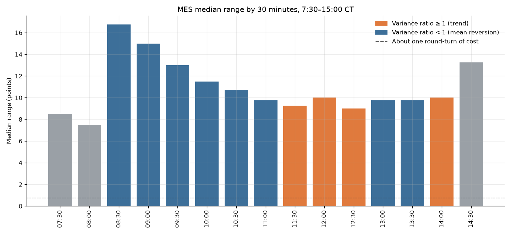

Thirty-minute buckets with at least 100 days. A bucket is dropped inside a day when it has fewer than 20 one-minute bars, which removes partial prints around a roll. Range is the high minus the low. The variance ratio uses that bucket and the next one: variance of the two-bucket sum, divided by twice the variance of the first bucket.

| clock | phase | days | mean move | median abs move | median range | autocorr | variance ratio |
|---|---|---:|---:|---:|---:|---:|---:|
| 17:00 | overnight | 1881 | -0.00 | 2.50 | 6.50 | — | — |
| 17:30 | overnight | 1881 | 0.13 | 1.50 | 4.00 | — | — |
| 18:00 | overnight | 1884 | -0.05 | 1.75 | 4.50 | — | — |
| 18:30 | overnight | 1887 | 0.04 | 1.75 | 4.25 | — | — |
| 19:00 | overnight | 1911 | 0.11 | 2.25 | 5.75 | — | — |
| 19:30 | overnight | 1911 | 0.01 | 1.75 | 4.75 | — | — |
| 20:00 | overnight | 1911 | -0.03 | 1.75 | 4.75 | — | — |
| 20:30 | overnight | 1910 | 0.14 | 2.00 | 4.75 | — | — |
| 21:00 | overnight | 1910 | -0.08 | 1.50 | 4.00 | — | — |
| 21:30 | overnight | 1909 | -0.12 | 1.25 | 3.50 | — | — |
| 22:00 | overnight | 1901 | 0.23 | 1.25 | 3.50 | — | — |
| 22:30 | overnight | 1908 | -0.11 | 1.25 | 3.00 | — | — |
| 23:00 | overnight | 1904 | -0.06 | 1.25 | 3.00 | — | — |
| 23:30 | overnight | 1905 | 0.13 | 1.25 | 3.25 | — | — |
| 00:00 | overnight | 1904 | -0.03 | 1.50 | 4.00 | — | — |
| 00:30 | overnight | 1905 | 0.14 | 1.75 | 4.25 | — | — |
| 01:00 | overnight | 1908 | 0.18 | 2.25 | 5.50 | — | — |
| 01:30 | overnight | 1908 | 0.03 | 2.00 | 4.75 | — | — |
| 02:00 | overnight | 1907 | 0.07 | 3.50 | 7.75 | — | — |
| 02:30 | overnight | 1906 | 0.10 | 2.75 | 6.50 | — | — |
| 03:00 | overnight | 1907 | 0.16 | 3.00 | 7.00 | — | — |
| 03:30 | overnight | 1907 | -0.06 | 2.25 | 5.75 | — | — |
| 04:00 | overnight | 1908 | 0.02 | 2.25 | 5.50 | — | — |
| 04:30 | overnight | 1907 | 0.07 | 2.00 | 5.25 | — | — |
| 05:00 | overnight | 1907 | -0.11 | 2.00 | 5.50 | — | — |
| 05:30 | overnight | 1905 | 0.28 | 2.25 | 5.50 | — | — |
| 06:00 | overnight | 1907 | 0.10 | 2.50 | 6.00 | — | — |
| 06:30 | overnight | 1908 | -0.23 | 2.25 | 5.75 | — | — |
| 07:00 | overnight | 1907 | 0.00 | 2.50 | 6.75 | — | — |
| 07:30 | overnight | 1908 | 0.10 | 3.50 | 8.50 | — | — |
| 08:00 | overnight | 1907 | 0.02 | 2.75 | 7.50 | — | — |
| 08:30 | rth | 1909 | 0.37 | 7.25 | 16.75 | -0.05 | 0.87 |
| 09:00 | rth | 1912 | -0.02 | 6.25 | 15.00 | 0.02 | 0.90 |
| 09:30 | rth | 1912 | -0.22 | 5.25 | 13.00 | -0.00 | 0.95 |
| 10:00 | rth | 1912 | 0.14 | 4.75 | 11.50 | -0.03 | 0.85 |
| 10:30 | rth | 1912 | 0.22 | 4.25 | 10.75 | 0.03 | 0.96 |
| 11:00 | rth | 1912 | -0.01 | 4.00 | 9.75 | -0.03 | 0.95 |
| 11:30 | rth | 1912 | 0.06 | 3.75 | 9.25 | 0.03 | 1.29 |
| 12:00 | rth | 1846 | -0.00 | 3.75 | 10.00 | 0.16 | 1.01 |
| 12:30 | rth | 1847 | 0.22 | 3.50 | 9.00 | -0.04 | 1.02 |
| 13:00 | rth | 1847 | -0.07 | 4.25 | 9.75 | -0.03 | 0.96 |
| 13:30 | rth | 1847 | 0.29 | 4.00 | 9.75 | -0.01 | 1.00 |
| 14:00 | rth | 1847 | -0.16 | 3.75 | 10.00 | 0.07 | 1.52 |
| 14:30 | rth | 1847 | -0.15 | 5.75 | 13.25 | — | — |
| 15:00 | after | 1311 | 0.17 | 3.00 | 7.25 | — | — |
| 15:30 | after | 1847 | 0.01 | 1.50 | 3.75 | — | — |

Cash-session move by weekday, 8:30 open to the last print before 15:00, same outright.

| day | sessions | mean | median |
|---|---:|---:|---:|
| Mon | 383 | 4.95 pts ($25 on 1 MES) | 4.25 pts ($21 on 1 MES) |
| Tue | 387 | -0.67 pts ($-3 on 1 MES) | -0.25 pts ($-1 on 1 MES) |
| Wed | 383 | 0.03 pts ($0 on 1 MES) | 2.25 pts ($11 on 1 MES) |
| Thu | 383 | -1.12 pts ($-6 on 1 MES) | 1.00 pts ($5 on 1 MES) |
| Fri | 376 | 0.74 pts ($4 on 1 MES) | 3.38 pts ($17 on 1 MES) |

Weekday differences of a point or two are smaller than the range inside the day. They are not a strategy.

## Every configuration, after costs

Expectancy is average dollars per trade after the fee and the slippage. A day with no fill is not a trade. Benchmarks are in the table and cannot be selected.

| rule | train n | train win | train $/trade | train net | val n | val win | val $/trade | val net | status |
|---|---:|---:|---:|---:|---:|---:|---:|---:|---|
| orb_5_opposite_1R | 1189 | 50.0% | $-8.39 | $-9,980.79 | 379 | 49.6% | $-9.45 | $-3,579.90 | train expectancy is not positive; train net is not positive; validation expectancy is not positive; validation net is not positive |
| orb_5_opposite_2R | 1189 | 42.9% | $-4.89 | $-5,809.54 | 379 | 39.8% | $-14.51 | $-5,499.90 | train expectancy is not positive; train net is not positive; validation expectancy is not positive; validation net is not positive |
| orb_5_opposite_time | 1189 | 42.6% | $-7.42 | $-8,819.54 | 379 | 40.4% | $-16.98 | $-6,436.15 | train expectancy is not positive; train net is not positive; validation expectancy is not positive; validation net is not positive |
| orb_5_mid_1R | 1196 | 46.8% | $-27.22 | $-32,553.27 | 383 | 50.1% | $-14.46 | $-5,537.68 | train expectancy is not positive; train net is not positive; validation expectancy is not positive; validation net is not positive |
| orb_5_mid_2R | 1196 | 36.0% | $-19.49 | $-23,312.02 | 383 | 36.3% | $-11.26 | $-4,311.43 | train expectancy is not positive; train net is not positive; validation expectancy is not positive; validation net is not positive |
| orb_5_mid_time | 1196 | 32.6% | $-18.56 | $-22,192.02 | 383 | 30.5% | $-18.03 | $-6,906.43 | train expectancy is not positive; train net is not positive; validation expectancy is not positive; validation net is not positive |
| orb_5_atr_1R | 1201 | 45.5% | $-42.03 | $-50,473.69 | 385 | 48.3% | $-28.95 | $-11,146.68 | train expectancy is not positive; train net is not positive; validation expectancy is not positive; validation net is not positive |
| orb_5_atr_2R | 1201 | 29.6% | $-47.36 | $-56,882.44 | 385 | 32.5% | $-29.11 | $-11,207.93 | train expectancy is not positive; train net is not positive; validation expectancy is not positive; validation net is not positive |
| orb_5_atr_time | 1201 | 19.6% | $-40.69 | $-48,866.19 | 385 | 20.8% | $-27.75 | $-10,685.43 | train expectancy is not positive; train net is not positive; validation expectancy is not positive; validation net is not positive |
| orb_15_opposite_1R | 1157 | 49.9% | $-5.31 | $-6,141.97 | 365 | 52.3% | $3.38 | $1,235.29 | train expectancy is not positive; train net is not positive |
| orb_15_opposite_2R | 1157 | 47.1% | $-0.28 | $-329.47 | 365 | 48.5% | $4.15 | $1,514.04 | train expectancy is not positive; train net is not positive |
| orb_15_opposite_time | 1157 | 47.1% | $-6.05 | $-7,003.22 | 365 | 48.5% | $0.63 | $229.04 | train expectancy is not positive; train net is not positive |
| orb_15_mid_1R | 1191 | 47.8% | $-20.46 | $-24,368.55 | 382 | 54.2% | $2.94 | $1,123.64 | train expectancy is not positive; train net is not positive |
| orb_15_mid_2R | 1191 | 39.4% | $-13.99 | $-16,657.30 | 382 | 42.7% | $9.30 | $3,552.39 | train expectancy is not positive; train net is not positive |
| orb_15_mid_time | 1191 | 38.5% | $-19.04 | $-22,674.80 | 382 | 40.6% | $2.74 | $1,046.14 | train expectancy is not positive; train net is not positive |
| orb_15_atr_1R | 1198 | 47.0% | $-34.98 | $-41,906.39 | 385 | 52.2% | $-13.16 | $-5,067.55 | train expectancy is not positive; train net is not positive; validation expectancy is not positive; validation net is not positive |
| orb_15_atr_2R | 1198 | 30.9% | $-40.47 | $-48,480.14 | 385 | 36.4% | $-7.95 | $-3,060.05 | train expectancy is not positive; train net is not positive; validation expectancy is not positive; validation net is not positive |
| orb_15_atr_time | 1198 | 23.8% | $-30.33 | $-36,330.14 | 385 | 29.4% | $6.59 | $2,537.45 | train expectancy is not positive; train net is not positive |
| orb_30_opposite_1R | 1094 | 49.4% | $-3.86 | $-4,225.97 | 336 | 50.3% | $-2.41 | $-809.07 | train expectancy is not positive; train net is not positive; validation expectancy is not positive; validation net is not positive |
| orb_30_opposite_2R | 1094 | 48.3% | $-0.89 | $-973.47 | 336 | 49.7% | $0.55 | $184.68 | train expectancy is not positive; train net is not positive |
| orb_30_opposite_time | 1094 | 47.9% | $-5.41 | $-5,919.72 | 336 | 47.0% | $-4.16 | $-1,399.07 | train expectancy is not positive; train net is not positive; validation expectancy is not positive; validation net is not positive |
| orb_30_mid_1R | 1176 | 49.2% | $-13.62 | $-16,022.50 | 377 | 51.7% | $-6.52 | $-2,458.04 | train expectancy is not positive; train net is not positive; validation expectancy is not positive; validation net is not positive |
| orb_30_mid_2R | 1176 | 43.0% | $-10.72 | $-12,601.25 | 377 | 44.0% | $-8.34 | $-3,143.04 | train expectancy is not positive; train net is not positive; validation expectancy is not positive; validation net is not positive |
| orb_30_mid_time | 1176 | 43.3% | $-12.30 | $-14,463.75 | 377 | 41.1% | $-12.68 | $-4,779.29 | train expectancy is not positive; train net is not positive; validation expectancy is not positive; validation net is not positive |
| orb_30_atr_1R | 1188 | 46.7% | $-35.01 | $-41,597.07 | 382 | 53.9% | $-6.61 | $-2,526.35 | train expectancy is not positive; train net is not positive; validation expectancy is not positive; validation net is not positive |
| orb_30_atr_2R | 1188 | 31.4% | $-39.32 | $-46,707.07 | 382 | 36.4% | $-8.65 | $-3,305.10 | train expectancy is not positive; train net is not positive; validation expectancy is not positive; validation net is not positive |
| orb_30_atr_time | 1188 | 26.3% | $-29.74 | $-35,329.57 | 382 | 28.5% | $-18.46 | $-7,050.10 | train expectancy is not positive; train net is not positive; validation expectancy is not positive; validation net is not positive |
| gap_fade_10bp | 873 | 50.6% | $-3.18 | $-2,772.36 | 219 | 53.9% | $6.75 | $1,477.56 | train expectancy is not positive; train net is not positive |
| gap_fade_25bp | 601 | 48.9% | $-4.32 | $-2,598.20 | 131 | 52.7% | $7.19 | $941.80 | train expectancy is not positive; train net is not positive |
| gap_go_10bp | 873 | 46.3% | $-18.26 | $-15,937.36 | 219 | 43.4% | $-23.64 | $-5,176.19 | train expectancy is not positive; train net is not positive; validation expectancy is not positive; validation net is not positive |
| gap_go_25bp | 601 | 48.8% | $-8.14 | $-4,893.20 | 131 | 44.3% | $-17.91 | $-2,345.70 | train expectancy is not positive; train net is not positive; validation expectancy is not positive; validation net is not positive |
| vwap_mr_0830_1030_1 | 719 | 70.0% | $-16.79 | $-12,074.00 | 238 | 73.1% | $-9.50 | $-2,261.52 | train expectancy is not positive; train net is not positive; validation expectancy is not positive; validation net is not positive |
| vwap_mr_0830_1030_1.5 | 860 | 63.8% | $-11.51 | $-9,897.52 | 277 | 65.3% | $-10.14 | $-2,808.43 | train expectancy is not positive; train net is not positive; validation expectancy is not positive; validation net is not positive |
| vwap_mr_1030_1200_1 | 558 | 57.0% | $-29.40 | $-16,407.37 | 192 | 63.0% | $-16.93 | $-3,250.75 | train expectancy is not positive; train net is not positive; validation expectancy is not positive; validation net is not positive |
| vwap_mr_1030_1200_1.5 | 570 | 48.9% | $-23.89 | $-13,614.77 | 191 | 50.8% | $-16.74 | $-3,197.49 | train expectancy is not positive; train net is not positive; validation expectancy is not positive; validation net is not positive |
| vwap_mr_1200_1400_1 | 524 | 65.8% | $-14.84 | $-7,775.38 | 175 | 62.3% | $-18.41 | $-3,221.52 | train expectancy is not positive; train net is not positive; validation expectancy is not positive; validation net is not positive |
| vwap_mr_1200_1400_1.5 | 597 | 53.9% | $-22.93 | $-13,688.63 | 192 | 52.6% | $-28.76 | $-5,522.52 | train expectancy is not positive; train net is not positive; validation expectancy is not positive; validation net is not positive |
| vwap_pb_0845_1100_1.5R | 739 | 39.1% | $-21.84 | $-16,136.22 | 258 | 38.8% | $-16.23 | $-4,186.79 | train expectancy is not positive; train net is not positive; validation expectancy is not positive; validation net is not positive |
| vwap_pb_0845_1100_2R | 739 | 32.3% | $-27.53 | $-20,346.22 | 258 | 34.1% | $-12.71 | $-3,278.04 | train expectancy is not positive; train net is not positive; validation expectancy is not positive; validation net is not positive |
| vwap_pb_0930_1200_1.5R | 664 | 36.9% | $-29.20 | $-19,387.80 | 215 | 43.7% | $-0.05 | $-10.86 | train expectancy is not positive; train net is not positive; validation expectancy is not positive; validation net is not positive |
| vwap_pb_0930_1200_2R | 664 | 30.1% | $-39.45 | $-26,195.30 | 215 | 37.7% | $-5.02 | $-1,079.61 | train expectancy is not positive; train net is not positive; validation expectancy is not positive; validation net is not positive |
| pd_fade | 489 | 36.8% | $-27.15 | $-13,274.05 | 173 | 41.0% | $-16.91 | $-2,925.97 | train expectancy is not positive; train net is not positive; validation expectancy is not positive; validation net is not positive |
| pd_break_1R | 728 | 48.1% | $-15.25 | $-11,105.37 | 205 | 48.3% | $-15.60 | $-3,197.89 | train expectancy is not positive; train net is not positive; validation expectancy is not positive; validation net is not positive |
| pd_break_2R | 728 | 42.9% | $-18.84 | $-13,716.62 | 205 | 42.4% | $-11.67 | $-2,392.89 | train expectancy is not positive; train net is not positive; validation expectancy is not positive; validation net is not positive |
| on_reclaim_mid | 777 | 31.0% | $-15.08 | $-11,717.61 | 252 | 28.2% | $-55.26 | $-13,926.08 | train expectancy is not positive; train net is not positive; validation expectancy is not positive; validation net is not positive |
| on_reclaim_1.5R | 782 | 37.5% | $-34.64 | $-27,090.91 | 254 | 40.9% | $-20.03 | $-5,088.37 | train expectancy is not positive; train net is not positive; validation expectancy is not positive; validation net is not positive |
| fh_15bp_1.5R | 715 | 46.6% | $1.07 | $765.06 | 171 | 51.5% | $12.95 | $2,213.66 | finalist |
| fh_15bp_time | 715 | 44.9% | $4.12 | $2,947.56 | 171 | 48.5% | $8.58 | $1,467.41 | passed the gates but lost the rank or the correlation cutoff |
| fh_25bp_1.5R | 489 | 46.8% | $4.78 | $2,339.46 | 103 | 53.4% | $7.45 | $767.35 | passed the gates but lost the rank or the correlation cutoff |
| fh_25bp_time | 489 | 45.4% | $6.59 | $3,220.71 | 103 | 52.4% | $12.98 | $1,337.35 | passed the gates but lost the rank or the correlation cutoff |
| late_1R | 888 | 48.9% | $-31.19 | $-27,697.80 | 288 | 48.6% | $-26.43 | $-7,610.70 | train expectancy is not positive; train net is not positive; validation expectancy is not positive; validation net is not positive |
| late_time | 888 | 26.2% | $-8.83 | $-7,844.05 | 288 | 20.8% | $-53.81 | $-15,498.20 | train expectancy is not positive; train net is not positive; validation expectancy is not positive; validation net is not positive |
| tod_0830_0930_long | 1200 | 30.7% | $-15.26 | $-18,310.53 | 382 | 25.7% | $-46.98 | $-17,947.36 | train expectancy is not positive; train net is not positive; validation expectancy is not positive; validation net is not positive |
| tod_0830_0930_short | 1200 | 26.8% | $-29.66 | $-35,595.53 | 382 | 28.0% | $-13.25 | $-5,059.86 | train expectancy is not positive; train net is not positive; validation expectancy is not positive; validation net is not positive |
| tod_0930_1030_long | 1199 | 46.8% | $-13.60 | $-16,308.53 | 379 | 46.4% | $-15.20 | $-5,760.31 | train expectancy is not positive; train net is not positive; validation expectancy is not positive; validation net is not positive |
| tod_0930_1030_short | 1199 | 41.8% | $-14.99 | $-17,973.53 | 379 | 42.2% | $-16.28 | $-6,170.31 | train expectancy is not positive; train net is not positive; validation expectancy is not positive; validation net is not positive |
| tod_1000_1130_long | 1199 | 46.8% | $-12.03 | $-14,426.97 | 379 | 42.7% | $-15.96 | $-6,049.78 | train expectancy is not positive; train net is not positive; validation expectancy is not positive; validation net is not positive |
| tod_1000_1130_short | 1199 | 41.4% | $-18.06 | $-21,658.22 | 379 | 41.2% | $-16.85 | $-6,386.03 | train expectancy is not positive; train net is not positive; validation expectancy is not positive; validation net is not positive |
| tod_1330_1500_long | 1161 | 39.9% | $-11.68 | $-13,561.20 | 366 | 43.4% | $-8.35 | $-3,054.55 | train expectancy is not positive; train net is not positive; validation expectancy is not positive; validation net is not positive |
| tod_1330_1500_short | 1161 | 35.9% | $-17.25 | $-20,022.45 | 366 | 37.4% | $-22.83 | $-8,355.80 | train expectancy is not positive; train net is not positive; validation expectancy is not positive; validation net is not positive |
| tod_1400_1500_long | 1156 | 38.3% | $-26.77 | $-30,949.86 | 367 | 43.1% | $-8.88 | $-3,257.91 | train expectancy is not positive; train net is not positive; validation expectancy is not positive; validation net is not positive |
| tod_1400_1500_short | 1156 | 41.0% | $-8.97 | $-10,363.61 | 367 | 42.0% | $-13.67 | $-5,016.66 | train expectancy is not positive; train net is not positive; validation expectancy is not positive; validation net is not positive |
| trend_vwap_ema | 1203 | 33.3% | $-30.78 | $-37,022.52 | 385 | 35.8% | $-10.42 | $-4,010.16 | train expectancy is not positive; train net is not positive; validation expectancy is not positive; validation net is not positive |
| bench_bh | 1203 | 54.0% | $0.35 | $418.59 | 385 | 53.0% | $2.12 | $816.55 | benchmark, not eligible |
| bench_bh_stop | 1203 | 42.4% | $-3.23 | $-3,882.66 | 385 | 39.0% | $-1.04 | $-400.95 | benchmark, not eligible |
| bench_random | 1203 | 50.7% | $-7.37 | $-8,860.64 | 385 | 49.1% | $-13.82 | $-5,318.80 | benchmark, not eligible |

## Selection

N for the multiple-testing penalty is 63. Benchmarks are excluded from that count.

Finalists are the rules that passed the train gate, the validation gate, and the neighbor gate, then ranked high enough and were not too correlated with a higher-ranked finalist. Adjusted p-values are reported beside them. A bad p-value does not hide the holdout result, and it does block a recommendation to trade.

| rule | why it is here | train $/trade | val $/trade | val trades | neighbors with val expectancy ≤ 0 |
|---|---|---:|---:|---:|---|
| fh_15bp_1.5R | passed train, validation, and the neighbor rule | $1.07 | $12.95 | 171 | 0 of 2 (none) |
| fh_25bp_time | passed the gates but lost the rank or the correlation cutoff | $6.59 | $12.98 | 103 | 0 of 2 (none) |
| orb_15_mid_2R | train expectancy is not positive; train net is not positive | $-13.99 | $9.30 | 382 | 3 of 6 (orb_5_mid_2R, orb_15_atr_2R, orb_30_mid_2R) |
| fh_15bp_time | passed the gates but lost the rank or the correlation cutoff | $4.12 | $8.58 | 171 | 0 of 2 (none) |
| fh_25bp_1.5R | passed the gates but lost the rank or the correlation cutoff | $4.78 | $7.45 | 103 | 0 of 2 (none) |
| gap_fade_25bp | train expectancy is not positive; train net is not positive | $-4.32 | $7.19 | 131 | 1 of 2 (gap_go_25bp) |

## Finalists, or the best rules that still failed

Holdout numbers below were computed once, after the names were locked. They are reported whether or not they made money.

| rule | split | trades | win rate | avg win | avg loss | $/trade | net | max drawdown | worst day | best day | avg qty |
|---|---|---:|---:|---:|---:|---:|---:|---:|---:|---:|---:|
| fh_15bp_1.5R | train | 715 | 46.6% | $152.85 | $-131.24 | $1.07 | $765.06 | $3,997.62 | $-199.97 | $291.28 | 1.9 |
| fh_15bp_1.5R | validation | 171 | 51.5% | $151.21 | $-133.65 | $12.95 | $2,213.66 | $1,503.23 | $-199.94 | $277.56 | 1.4 |
| fh_15bp_1.5R | holdout | 135 | 54.1% | $129.49 | $-115.61 | $16.93 | $2,285.07 | $1,206.78 | $-197.47 | $282.56 | 1.3 |

| rule | bootstrap p | adjusted bootstrap p | sign-flip p | adjusted sign-flip p | share of random nulls at least this high |
|---|---:|---:|---:|---:|---:|
| fh_15bp_1.5R | 0.151 | 1.000 | 0.135 | 1.000 | 0.0% |

The bootstrap asks how often a resample of this rule's own validation days has a mean at or below zero. It uses every validation session, including days with no trade, because a Combine lives through those days too. The sign-flip asks how often scrambling the sign of those days still looks as good as the real result. The last column compares the rule with the random-entry null (an 8-point stop, an 8-point target, and a 10:30 exit). Adjusted values multiply the raw p-value by the 63 eligible tests and cap the result at 1.

The other three first-hour settings also cleared the train and validation gates. They are the same idea with a higher threshold or a time exit, so their validation days move together and only the top score was held out. They did not get a second look at 2025-07 through 2026-09.

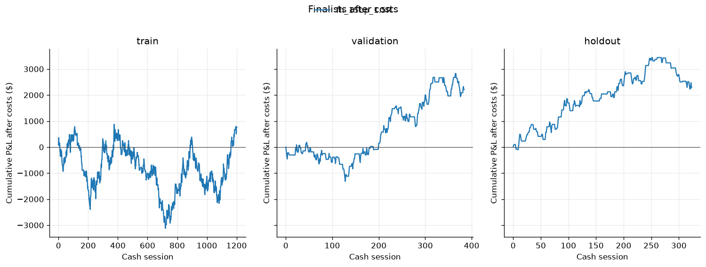

## Combine attempts

Each month inside a split starts a fresh $50,000 attempt. The attempt cannot see the next split. Pass means +$3,000 before a $1,000 intraday daily loss or a touch of the trailing $2,000 floor, and the best closed day is under half of profits. Resolved pass rate ignores attempts that ran out of calendar. The all-starts rate counts those unfinished attempts as failures, which is the number that matters if you buy a Combine on a random month.

| book | split | starts | passed | failed | censored | resolved pass rate | all-starts pass rate | median days to pass | passes that also met 40% |
|---|---|---:|---:|---:|---:|---:|---:|---:|---:|
| fh_15bp_1.5R | train | 56 | 4 | 39 | 13 | 9.3% | 7.1% | 164.0 | 4 |
| fh_15bp_1.5R | validation | 18 | 6 | 0 | 12 | 100.0% | 33.3% | 210.0 | 6 |
| fh_15bp_1.5R | holdout | 15 | 2 | 0 | 13 | 100.0% | 13.3% | 232.5 | 2 |

Read the all-starts column, not the resolved one. A random month passed in 4 of 56 train starts (7%), 6 of 18 validation starts (33%), and 2 of 15 holdout starts (13%). The passes that happened took a median of 164, 210, and 232 sessions, on the order of eight to eleven months. In the long train window, 39 of 56 starts died on the trailing $2,000 loss and none died on the $1,000 daily limit. In the shorter later windows the book usually had neither passed nor failed when the data ran out. Every pass that did occur also had its best day under 40% of profits, so the consistency rule was not what stopped it. A one-dollar train edge does not pay for a Combine. It bleeds into the trailing floor.

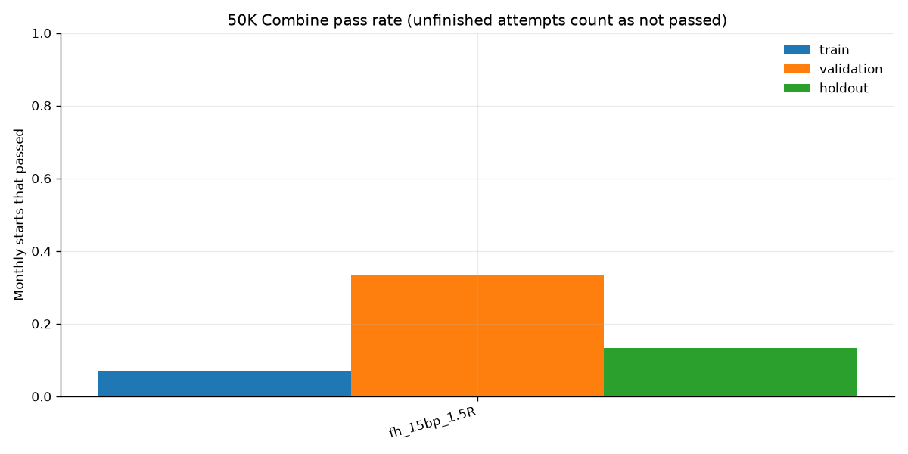

## What no edge looks like

Two buy-and-hold benchmarks buy one direction at 8:30 and flatten at 15:00. One has no stop and is always 1 MES. The other uses a 20-point stop and the $200 sizer. The random benchmark flips a coin from the session date (seed 7), enters at 9:00 with an 8-point stop and an 8-point target, and flattens at 10:30. One hundred more seeds, 1000 through 1099, were run on train and validation only.

Random-seed validation expectancy: mean $-16.30, median $-16.30, 5th percentile $-18.79, 95th percentile $-13.82, share positive 0.0%.
Train: mean $-15.92, median $-15.92, share positive 0.0%.

Those 100 seeds are only two books. Adding an even number or an odd number to the date flips every day the same way, so half the seeds are one coin-flip and half are its mirror. Both mirrors lost money, about $7 to $24 per trade. Beating that null is a low bar: a coin-flip with an 8-point stop and an 8-point target loses to costs. It shows what no edge looks like. It does not prove that a rule which lost less is a real edge. The bootstrap on the rule's own days is the check that matters. Buying 1 MES at 8:30 and holding to 15:00 with no stop made $0.35 per day in train and $2.12 in validation. The same buy with a 20-point stop lost money in both windows. The cash-session drift is real and too small to pay for a stop.


## Recommendation for the live bot

Do not change the live bot. Do not switch the morning to first-hour momentum, and do not loosen the chop filter or the 2-tick retest to force more trades. `fh_15bp_1.5R` does not clear the predeclared adjusted p-value cutoff of 0.10. Counting all 63 tests, the result is indistinguishable from luck, even though the holdout dollars happened to stay positive. The earlier seven-year replay of the live opening-range retest was already about 102 trades, a 38% win rate, and a loss of roughly $7 a trade. This broader search does not rescue it and does not offer a substitute. Leave the live settings where they are. A new Combine attempt is not justified by this file. The MNQ, correlation, and event-day results below do not change that.

## MNQ, same menu, second look

The file is Databento `MNQ.v.0`, 2,611,921 one-minute bars, 1,912 cash sessions, 30 rolls, 31 contracts, 2019-05-06 through 2026-09-30. The splits are the same dates as MES: train 1,203 sessions (through 2023-12-29), validation 385 (2024-01-02 through 2025-06-30), holdout 324 (2025-07-01 through 2026-09-30). TopstepX lists the Micro E-mini Nasdaq-100 round turn at **$1.22**, the same published total as MES, read on 2026-10-10 from the commissions page. That page does not print a separate commission, exchange, and NFA split for MNQ, so this note does not invent one. A market or stop round turn is $2.22 all-in (the fee plus two $0.50 ticks). One MNQ point is $2. The live config still says $1.40 and still trades MES.

The 63 rules were written for the MES study and locked before those MES results were scored. They were not designed from MNQ data. Reusing the menu on MNQ happened after the MES study was finished. The MNQ holdout was not used to pick the menu or the MNQ finalists. This is a second look at a menu that already existed. Multiplying MNQ's p-values by 63 does not undo the earlier look at MES.

Twelve configurations cleared the train gate, the validation gate, and the neighbor gate. Every one of them is an opening-range rule or a first-hour rule. The rank kept three whose validation days were not too alike. No combined book of those three was formed. The other nine, including the other first-hour settings and `orb_15_opposite_1R`, were not held out. Every row is in `docs/research/mnq_results.json`.

| rule | split | trades | win rate | $/trade | net | avg qty | max drawdown |
|---|---|---:|---:|---:|---:|---:|---:|
| fh_15bp_1.5R | train | 499 | 48.5% | $7.98 | $3,981.08 | 1.42 | $2,073.98 |
| fh_15bp_1.5R | validation | 87 | 55.2% | $38.81 | $3,376.60 | 1.09 | $830.82 |
| fh_15bp_1.5R | holdout | 39 | 51.3% | $32.06 | $1,250.42 | 1.00 | $612.04 |
| orb_15_opposite_2R | train | 853 | 50.1% | $6.22 | $5,305.56 | 1.64 | $1,970.68 |
| orb_15_opposite_2R | validation | 218 | 50.0% | $16.98 | $3,700.62 | 1.17 | $1,043.50 |
| orb_15_opposite_2R | holdout | 85 | 52.9% | $10.38 | $882.26 | 1.08 | $577.54 |
| orb_30_opposite_1R | train | 653 | 53.3% | $5.62 | $3,666.60 | 1.52 | $1,160.90 |
| orb_30_opposite_1R | validation | 134 | 53.7% | $7.58 | $1,015.84 | 1.14 | $884.82 |
| orb_30_opposite_1R | holdout | 45 | 60.0% | $31.62 | $1,422.88 | 1.02 | $491.26 |

| rule | bootstrap p | adjusted bootstrap p | sign-flip p | adjusted sign-flip p |
|---|---:|---:|---:|---:|
| fh_15bp_1.5R | 0.0195 | 1.000 | 0.0155 | 0.976 |
| orb_15_opposite_2R | 0.0470 | 1.000 | 0.0565 | 1.000 |
| orb_30_opposite_1R | 0.221 | 1.000 | 0.208 | 1.000 |

The cutoff written down before any of this was an adjusted p-value of 0.10. All three are above it. `fh_15bp_1.5R` has a raw validation bootstrap p-value of 0.0195. Times 63 that is above 1, so the adjusted value is 1.000. A raw p-value that looks small before the penalty is not a finding. The holdout dollars stayed positive on 39, 85, and 45 trades. That is the same direction as validation. It is not significance, and the holdout was not a fresh design. Average size fell to about one contract by the holdout because the stop, in points, no longer fits a second contract inside $200.

The other first-hour settings also cleared the gates and were not held out. `fh_15bp_time` made $8.24 a trade in train (499 trades) and $35.51 in validation (87). `fh_25bp_1.5R` made $7.44 (362) and $11.44 (47). `fh_25bp_time` made $5.86 (362) and $9.73 (47). They are the same idea with a higher threshold or a time exit.

`orb_15_opposite_1R` also cleared the gates: train 853 trades, 52.2%, $2.96 a trade; validation 218 trades, 55.5%, $15.69. It lost the rank to the 2R version of the same entry, so the 63-rule screen did not open its holdout. It is the opening-range baseline in the event section below because that baseline was named before these MNQ ranks existed. The live bot is still a 2-tick retest, not any of these research opening-range rules.

The predeclared null still uses an 8-point stop and an 8-point target. On MNQ the median half hour is 45.25 points and the 8:30 half hour's median range is 92.5 points, so an 8-point stop is noise. Train null expectancy averaged −$44.71 and validation averaged −$52.20. All 100 seeds were negative in both windows. Beating that null is almost free. The bootstrap is the test that counts. Those 100 seeds are still only two books, even and odd, the same way they were on MES.

The cash session gained 3.31 points a day on average, about $7 on one MNQ. The widest half hour is 8:30 (median range 92.5 points). The quietest is 12:30 (40.75). That is the same shape as MES, at about four times the points. The 8:30 bucket's variance ratio is 0.80, the fade side of 1, and the highest variance ratio in the day is 0.95 at 10:30. The open is wide. It is not a clean trend inside the half hour.

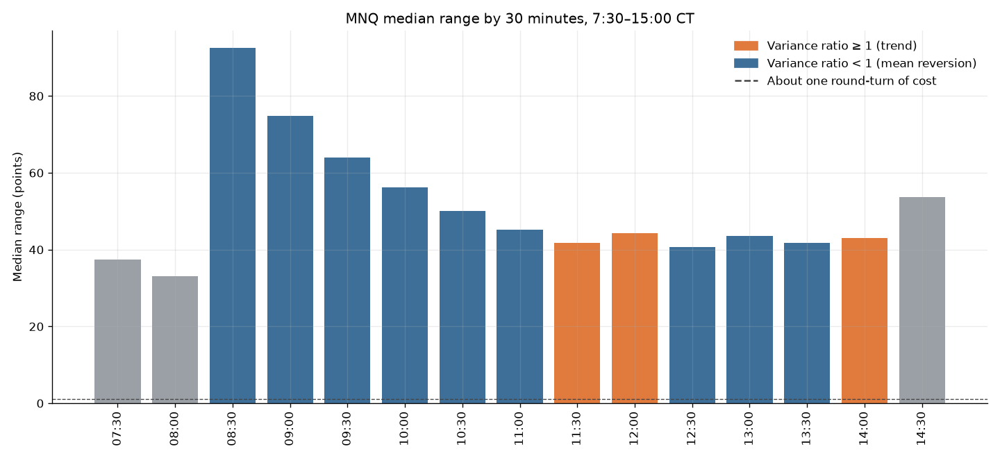

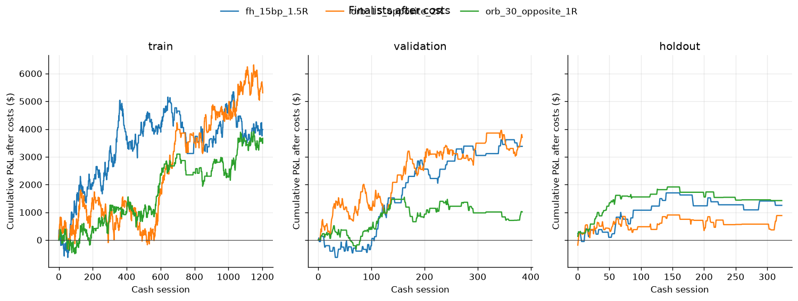

## How ES and NQ move together

All 1,912 cash sessions match. Correlation below is Pearson correlation of percent returns, so the different point values do not inflate it. Daily return is the 8:30 open to the last cash bar before 15:10. One-minute returns are close to close of exact consecutive minutes. A gap is not bridged.

| horizon | correlation | notes |
|---|---:|---|
| Daily cash session | 0.929 | 1,912 days |
| 30-minute path | 0.923 | from the 8:30 open, then close to close |
| 5-minute path | 0.924 | same construction |
| 1-minute | 0.922 | 732,030 aligned minutes |

They move together. On 12.1% of days the cash-session returns have opposite signs. On 16.6% of days the first hours have opposite signs. The other days, the large majority, have the same sign.

The loose part of the day is the open. Correlation of 1-minute returns is 0.856 from 8:31 through 8:59, 0.919 in the 9:00 half hour, and it rises to 0.956 at 13:30. The afternoon is the tight part of the day. The first half hour is where a divergence is least surprising, and even there the correlation is still strongly positive.

| year | days | daily correlation |
|---|---:|---:|
| 2019 | 171 | 0.929 |
| 2020 | 259 | 0.899 |
| 2021 | 258 | 0.861 |
| 2022 | 258 | 0.964 |
| 2023 | 257 | 0.923 |
| 2024 | 259 | 0.933 |
| 2025 | 257 | 0.973 |
| 2026 | 193 | 0.920 |

| prior-close VIX | days | daily correlation |
|---|---:|---:|
| under 15 | 397 | 0.893 |
| 15 to just under 20 | 786 | 0.922 |
| 20 and above | 729 | 0.937 |

The loosest year in this file is 2021. The rolling 60-session correlation of daily returns has median 0.932, a high of 0.991 on 2025-06-30, and a low of 0.665 on 2021-08-17. Of 1,853 windows, 64 printed below 0.80, and all 64 are in 2021. None printed below 0.50. They also lock together a bit more when the prior VIX close is high, and a bit less when it is under 15. "A bit" is the right size: 0.89 versus 0.94.

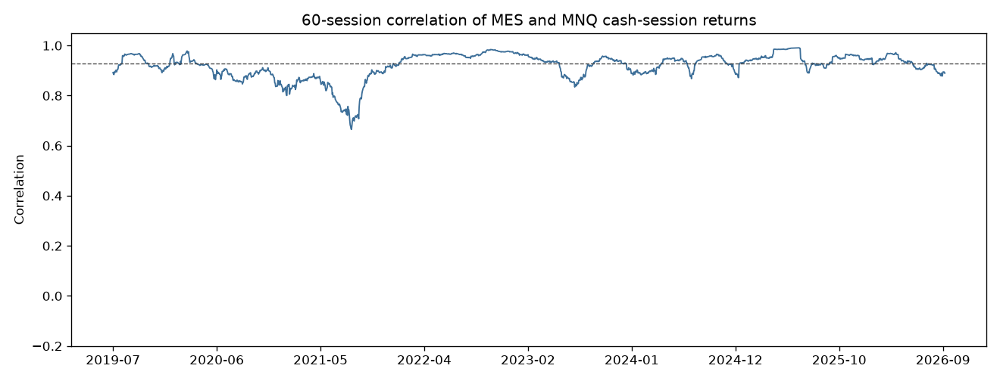

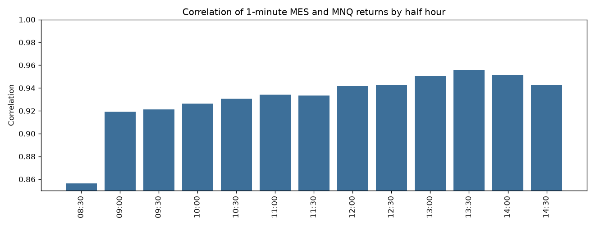

Lead-lag uses the correlation of the MES return ending at minute t with the MNQ return ending at t+k, for k from −5 to +5. A positive lag is MNQ's later minute. Lag 0 is 0.922. Lag +1 is 0.0135 and lag −1 is 0.0134, on about 730,000 pairs each. The other lags are around zero. One index does not lead the other by a minute. There is no one-minute head start to trade.

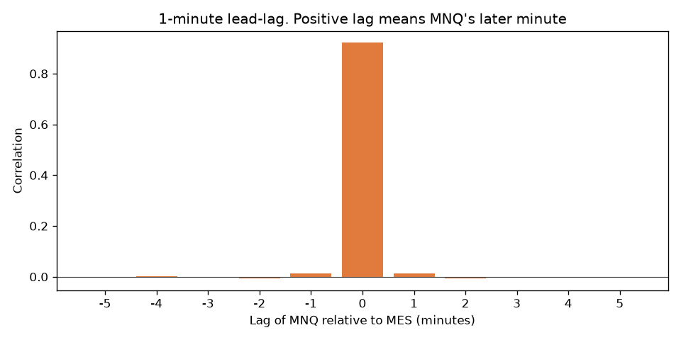

One MNQ is the more volatile contract in dollars, because it moves so many more points. The standard deviation of the daily cash-session point change is 39.7 points on MES and 183.7 points on MNQ. One MES point is $5 and one MNQ point is $2, so that is $198 a day on one MES and $367 a day on one MNQ. MNQ moves about 4.6 times as many points and about 1.85 times as many dollars.

The ratio is the MNQ close divided by the MES close, which is the same number as NQ/ES. It started this sample at 2.66 and ended at 3.98. The median is 3.42. The autocorrelation of daily ratio changes is −0.03. The ratio drifted up for years. It did not snap back from one day to the next.

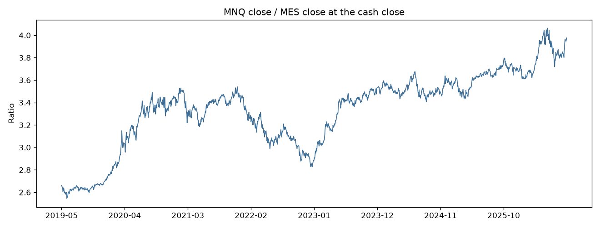

## Four cross-market rules

These four were written in `research/cross.py` before they were scored. They are not part of the 63. N for their p-values is 4. A candidate needs 40 train trades and 20 validation trades, positive expectancy and net in both, and validation expectancy at least 25% of train. The holdout was opened only for candidates. Adjusted p = min(1, raw validation bootstrap p × 4). Above 0.10 is not a recommendation.

1. `x_confirm_mes`. Trade MES with `fh_15bp_1.5R` only when MNQ's first hour has the same sign and is also at least 15bp.
2. `x_confirm_mnq`. The mirror on MNQ, requiring MES to agree by 15bp.
3. `x_diverge_fade`. If the two first hours have opposite signs and each is at least 15bp, fade the market with the larger move. Stop at that market's first-hour extreme. Target its 8:30 open. Flat at 12:00 CT.
4. `x_ratio_revert`. At 9:30, if the MNQ/MES ratio is more than 0.75% away from the median of the prior 20 cash closes, short the rich leg and buy the cheap leg. Each leg risks $100 with a 0.5% stop. Both legs have to fit at least one contract.

| rule | candidate | train n | train $/trade | val n | val $/trade | holdout n | holdout $/trade | bootstrap p | adjusted p |
|---|---|---:|---:|---:|---:|---:|---:|---:|---:|
| x_confirm_mes | yes | 577 | $6.02 | 149 | $10.91 | 111 | $12.28 | 0.212 | 0.848 |
| x_confirm_mnq | yes | 302 | $6.68 | 35 | $25.17 | 15 | $80.25 | 0.193 | 0.772 |
| x_diverge_fade | no | 32 | $1.53 | 1 | $67.28 | — | — | — | — |
| x_ratio_revert | no | 135 | −$11.81 | 0 | — | — | — | — | — |

Requiring the other index to confirm did not improve the rule that was already on the table. Unfiltered MES `fh_15bp_1.5R` made $12.95 in validation and $16.93 on the holdout. The confirmed version made $10.91 and $12.28. Train looked better ($6.02 versus $1.07) because the filter keeps the days that already moved 15bp in both indexes. That is the in-sample cut. The later windows did not pay more per trade, and the adjusted p-value is 0.85.

The MNQ confirmation has 35 validation trades, under the 40-trade gate used for the 63, and 15 holdout trades. The holdout win rate is 66.7% and the holdout average is $80.25. That is a handful of trades. The p-value was computed on the validation days, and the adjusted value is 0.77. Unfiltered MNQ first-hour momentum made $38.81 in validation on 87 trades. The filter cut that to $25.17 on 35.

The fade almost never fired once both first hours had to be 15bp and opposite. Train was 32 trades and $1.53 a trade. Validation was one trade. There is no holdout.

The ratio rule lost $11.81 a trade on 135 train trades (win rate 35.6%, net −$1,594). Validation took zero trades. A 0.5% stop on one micro does not fit inside $100 once the indexes are high: 0.5% of a 5,000 MES is 25 points, and 25 × $5 is already $125 before fees. The same stop on MNQ is larger than $100 as well. Both legs have to be at least one contract, so the rule goes silent. The stop and the $100 risk were not widened after that result. The ratio's own path, a multi-year rise with no day-to-day snapback, is the other reason a fade of the ratio was a bad bet in this sample.

## Event days

Tags cover both files. A session is red when it is NFP, CPI, or an FOMC decision day. That set was written down before the trade results. PPI, ISM, notation votes, OPEX, roll week, half days, month-end, and VIX regime are tags for description. They are not extra filters. There are about fourteen tags, two predeclared rules, and two markets, scored on train and on validation. That is a pile of slices. A slice that looks good is not a new rule.

NFP, CPI, and PPI are 8:30 AM ET, which is 7:30 AM CT, before the cash open. First-hour momentum on those days is the reaction, not the print. ISM manufacturing and services are 10:00 AM ET, which is 9:00 AM CT, inside the 8:30–9:30 signal window. FOMC decisions are typically 2:00 PM ET, which is 1:00 PM CT, after the 9:30 entry, so a morning trade is still on when the statement hits. US data is not released at 8:30 CT. 8:30 CT is the stock open.

Sources, retrieved 2026-10-10:

- NFP, CPI, and PPI: BLS Schedule of Selected Releases. `bls.gov` returned HTTP 403, so the annual pages were read from the Wayback Machine. Only 8:30 AM ET rows named "Employment Situation for", "Consumer Price Index for", or "Producer Price Index for" were kept. The files hold 95, 95, and 95 dates.
- FOMC: statement links `monetaryYYYYMMDDa.htm` on the Fed's current calendar page, plus the 2019 and 2020 historical pages. The historical pages' "Released" dates are often the minutes, so those dates were not used. Sixty-four decision days, including the unscheduled statements on 2019-10-11, 2020-03-03, and 2020-03-15. Four notation votes (2020-03-23, 2020-03-31, 2020-08-27, 2025-08-22) are tagged `fomc_notation` and are not red. Sunday 2020-03-15 is applied to the Monday cash session.
- VIX: Cboe `VIX_History.csv`. FRED `VIXCLS` returned HTTP 500. Closes used here run through 2026-10-09. High is a prior close of 20 or above. Low is under 15. Those round numbers were not fit to the trades.
- ISM: the standing rule, manufacturing on the first NYSE business day and services on the third, 10:00 AM ET. A published shift off that rule is not listed.
- Half days: the NYSE 1:00 PM ET pattern (Friday after Thanksgiving, July 3 when July 4 is Tuesday–Friday, December 24 when it is a weekday and not the observed Christmas close). An early close outside that pattern is missed. These are not bar-verified CME halts.
- OPEX is the third Friday, moved to the prior weekday if that Friday is a full NYSE close. Quad witching is the March, June, September, and December OPEX. Roll week is the Monday–Friday cash sessions of the week that contains that expiration. Volume often shifts the week before. This study uses one definition.
- Month-end is the last loaded cash session of the calendar month.

Gaps: the archived 2025 BLS schedule has no CPI, Employment Situation, or PPI row for the October 2025 reference month. September 2025 CPI on 2025-10-24, September employment on 2025-11-20, and September PPI on 2025-11-25 are tagged. The missing October reference month is the funding-lapse gap. `fomchistorical2021.htm` through `fomchistorical2024.htm` returned 404; those years were taken from the current calendar page instead.

On the 1,912 matched cash sessions the tags land 87 NFP, 88 CPI, 88 PPI, 61 FOMC decisions, 4 notation votes, 88 ISM manufacturing, 88 ISM services, 89 OPEX, 30 quad witching, 147 roll-week sessions, 15 half days, and 89 month-ends. VIX is high on 729 sessions, mid on 786, and low on 397. Red is 233 sessions.

Skipping red days is "supported" only if, on train and on validation, the non-red book has higher expectancy than the all-days book, the non-red net is positive, and the non-red validation sample has at least 40 trades. The holdout of a filtered book was opened only where that was true. One book passed: MES `fh_15bp_1.5R`. The holdout then reversed it.

| book | split | all n | all $/trade | red n | red $/trade | other days n | other $/trade |
|---|---|---:|---:|---:|---:|---:|---:|
| MES fh_15bp_1.5R | train | 715 | $1.07 | 85 | −$8.30 | 630 | $2.33 |
| MES fh_15bp_1.5R | validation | 171 | $12.95 | 24 | −$9.23 | 147 | $16.57 |
| MES fh_15bp_1.5R | holdout | 135 | $16.93 | 16 | $32.61 | 119 | $14.82 |
| MES orb_15_opposite_1R | train | 1157 | −$5.31 | 136 | −$0.11 | 1021 | −$6.00 |
| MES orb_15_opposite_1R | validation | 365 | $3.38 | 44 | $22.50 | 321 | $0.76 |
| MES orb_15_opposite_1R | holdout | 295 | $0.19 | 35 | −$14.63 | 260 | $2.18 |
| MNQ fh_15bp_1.5R | train | 499 | $7.98 | 58 | $13.81 | 441 | $7.21 |
| MNQ fh_15bp_1.5R | validation | 87 | $38.81 | 5 | $34.64 | 82 | $39.07 |
| MNQ fh_15bp_1.5R | holdout | 39 | $32.06 | 2 | −$15.97 | 37 | $34.66 |
| MNQ orb_15_opposite_1R | train | 853 | $2.96 | 90 | $9.83 | 763 | $2.15 |
| MNQ orb_15_opposite_1R | validation | 218 | $15.69 | 21 | $50.07 | 197 | $12.02 |
| MNQ orb_15_opposite_1R | holdout | 85 | $3.77 | 9 | −$30.61 | 76 | $7.85 |

On MES first-hour momentum, train and validation made their money on the other days, and the red days lost about $8 to $9 a trade. That is why the skip gate passed. The holdout red days made $32.61 a trade (16 trades, net $522) and the other days made $14.82, which is worse than the unfiltered $16.93. The filter that was chosen on the first two windows threw away the better holdout days.

The red label is also a mixture. On MES first-hour momentum in train, NFP made $36.19 a trade (32 trades, net $1,158), CPI lost $25.35 (34 trades, net −$862), and FOMC lost $57.19 (20 trades, net −$1,144). Validation NFP flipped to −$8.01 on 9 trades. The train loss on "red" is CPI and FOMC swamping NFP. That is a description of three small slices. It is not a reason to trade only NFP or to drop CPI after the fact.

MNQ first-hour momentum does not support a skip. In train the red days were the better slice ($13.81 versus $7.21). Validation has 5 red trades. The two MNQ opening-range finalists tell the same story in train and validation: `orb_15_opposite_2R` red expectancy was $13.30 in train and $34.18 in validation, against $6.22 and $16.98 on all days. `orb_30_opposite_1R` was worse on red days in train (−$13.19) and better on 8 red validation trades ($25.84). The both-windows gate fails. The MNQ opening-range baseline was also better on red days in train and in validation. Skipping those days would have cut the better slice.

One ugly descriptive cell, so the size of the temptation is on the page: MNQ first-hour momentum lost $85.67 a trade on 25 train PPI days. The same cell in validation was +$92.95 on 6 trades. A tag that large, in a list this long, that then flips, is why the red set was not edited after the results.

## Combine: MNQ, the pair, and red days

Same Combine as the MES section. Unfinished attempts count as not passed. Read the all-starts column.

| book | split | starts | passed | failed | censored | all-starts pass rate | median days | passes that also met 40% |
|---|---|---:|---:|---:|---:|---:|---:|---:|
| MNQ fh_15bp_1.5R | train | 56 | 11 | 16 | 29 | 19.6% | 236 | 11 |
| MNQ fh_15bp_1.5R | validation | 18 | 6 | 0 | 12 | 33.3% | 149 | 6 |
| MNQ fh_15bp_1.5R | holdout | 15 | 0 | 0 | 15 | 0% | — | 0 |
| MNQ orb_15_opposite_2R | train | 56 | 27 | 6 | 23 | 48.2% | 391 | 27 |
| MNQ orb_15_opposite_2R | validation | 18 | 3 | 0 | 15 | 16.7% | 216 | 3 |
| MNQ orb_15_opposite_2R | holdout | 15 | 0 | 0 | 15 | 0% | — | 0 |
| MNQ orb_30_opposite_1R | train | 56 | 16 | 0 | 40 | 28.6% | 805.5 | 16 |
| MNQ orb_30_opposite_1R | validation | 18 | 0 | 0 | 18 | 0% | — | 0 |
| MNQ orb_30_opposite_1R | holdout | 15 | 0 | 0 | 15 | 0% | — | 0 |
| MES + MNQ fh, 50/50 | train | 56 | 1 | 26 | 29 | 1.8% | 333 | 1 |
| MES + MNQ fh, 50/50 | validation | 18 | 7 | 0 | 11 | 38.9% | 250 | 7 |
| MES + MNQ fh, 50/50 | holdout | 15 | 0 | 0 | 15 | 0% | — | 0 |
| MES fh, skip red | train | 56 | 6 | 31 | 19 | 10.7% | 400.5 | 6 |
| MES fh, skip red | validation | 18 | 8 | 0 | 10 | 44.4% | 195.5 | 8 |
| MES fh, skip red | holdout | 15 | 0 | 0 | 15 | 0% | — | 0 |

Every MNQ finalist holdout attempt was still running when the file ended. Zero of 15 passed. The train pass rates look kinder than MES because the dollar swings are larger, and they come with the same problem: the passes take hundreds of sessions, and the holdout does not finish. `orb_30_opposite_1R` passed 16 of 56 train starts and then passed none in validation or the holdout. Every pass that did occur also met the 40% consistency path. Failures that happened were the trailing $2,000 loss.

The paired book puts half the dollars on MES `fh_15bp_1.5R` and half on the same rule in MNQ. Train passed 1 of 56 starts and failed 26 on the trailing loss. Validation passed 7 of 18 and left 11 unfinished. The holdout passed none. Halving each book makes the $3,000 target harder. The pair does not get a red-day filter: MNQ first-hour momentum did not support the skip, and the rule required both books to support it.

The one supported filter, skipping red days on MES first-hour momentum, raised the train all-starts rate from 7.1% to 10.7% and the validation rate from 33.3% to 44.4%. The holdout rate went from 2 of 15 to 0 of 15. That is the same reversal as the per-trade numbers. The filter is not supported by the split that was not used to choose it.

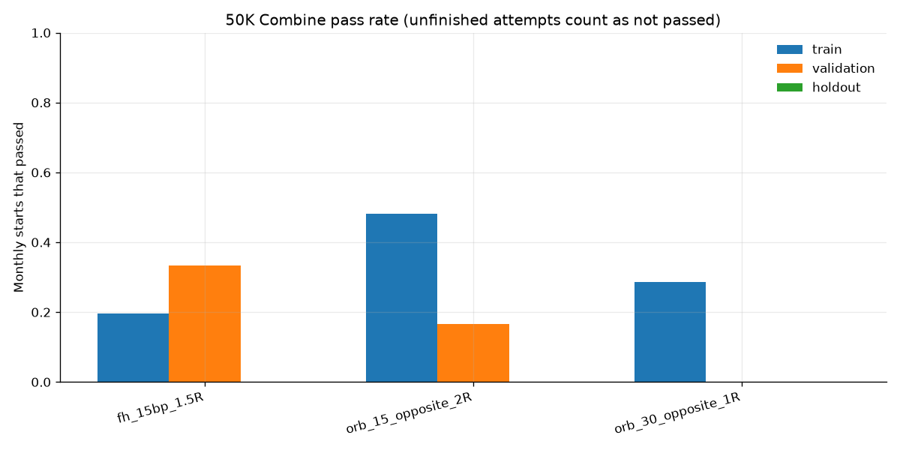

## Recommendation after MNQ, correlation, and events

Do not change the live bot. Do not switch to first-hour momentum on MES or on MNQ. Do not trade the three MNQ finalists. Do not require the other index to confirm. Do not fade an ES/NQ divergence or the NQ/ES ratio. Do not skip NFP, CPI, or FOMC days. Adjusted p-values for the three MNQ finalists are 1.000. The two cross rules that qualified have adjusted p-values of 0.85 and 0.77. The fade and the ratio rule did not qualify. The only event filter that cleared its own train and validation gate failed the holdout, and it made the Combine holdout worse. Positive dollars with an adjusted p-value of 1 are not an edge. The M2K screen, the Russell and yield checks, and the Sunday reopen are below. They do not change this.

## M2K, same 63 rules

The file is Databento `M2K.v.0`, 2,474,367 one-minute bars, 1,912 cash sessions, 30 rolls, 31 contracts, 2019-05-06 through 2026-09-30. The splits are the same dates as MES and MNQ. CME's micro Russell is a 0.10-point tick and $5 a point, so a tick is $0.50. TopstepX lists the Micro E-mini Russell 2000 round turn at **$1.22**, read on 2026-10-12 from the same commissions page, in the row next to MES. That page does not print a separate commission, exchange, and NFA split for M2K. A market round turn is $2.22 all-in. The October 2026 CME increase on that page is still MCL and MNG. The live config still says $1.40 and still trades MES.

No rule cleared the gates. Of the 63 eligible configurations, none stayed positive after costs on both train and validation. The holdout was not opened. There is no finalist, no adjusted p-value, and no Combine simulation, because those steps run only after a rule has already qualified.

Six configurations made money in train. All six lost money in validation.

| rule | train n | train $/trade | train net | val n | val $/trade | val net |
|---|---:|---:|---:|---:|---:|---:|
| fh_15bp_1.5R | 977 | $2.07 | $2,022 | 296 | −$4.63 | −$1,371 |
| fh_15bp_time | 977 | $1.74 | $1,705 | 296 | −$2.08 | −$616 |
| fh_25bp_1.5R | 842 | $4.42 | $3,719 | 246 | −$11.40 | −$2,805 |
| fh_25bp_time | 842 | $5.32 | $4,481 | 246 | −$2.86 | −$705 |
| gap_go_25bp | 810 | $2.70 | $2,189 | 253 | −$21.79 | −$5,513 |
| tod_0830_0930_short | 1202 | $2.14 | $2,569 | 385 | −$16.26 | −$6,262 |

First-hour momentum, which was the MES finalist and an MNQ finalist, made about $2 a trade in the M2K train window and lost money in validation. The best validation number in the whole menu is `gap_fade_25bp`, at $10.49 a trade (253 trades, net $2,655). The same rule lost $17.02 a trade in train (810 trades, net −$13,784). A rule that loses for four years and then makes money is not a pass.

The 8-point random null lost about $9.05 a trade in train and $8.77 in validation. All 100 seeds were negative. On M2K the median half hour is 6.5 points and the 8:30 half hour is 15.5, so an 8-point stop is a real stop, not the noise it was on MNQ. The null still loses to costs. Nothing in the menu beat both windows. The cash session itself averaged −0.40 points a day, about −$2 on one M2K. The open is still the wide half hour. Every row is in `docs/research/m2k_results.json`.

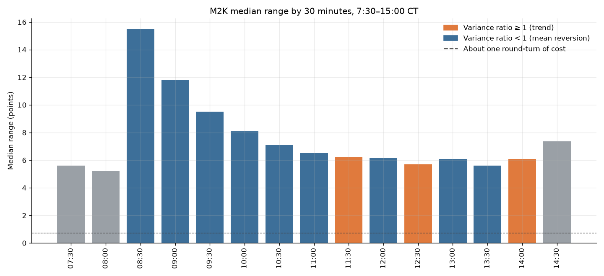

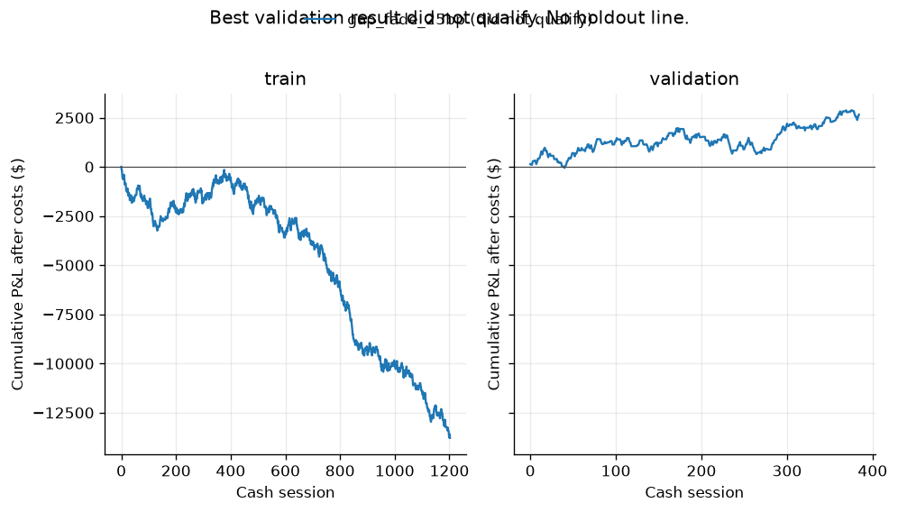

## What Russell, VIX, and yields add

M2K lines up with MES and MNQ on all 1,912 cash sessions. One M2K is the quiet micro. The standard deviation of the daily cash-session point change is 23.4 points, which is $117 on one M2K, against $198 on one MES and $367 on one MNQ.

| pair | daily | 30-minute | 5-minute | 1-minute |
|---|---:|---:|---:|---:|
| M2K vs MES | 0.814 | 0.822 | 0.812 | 0.791 |
| M2K vs MNQ | 0.716 | 0.721 | 0.727 | 0.716 |

They move together, and less tightly than ES and NQ (daily correlation 0.929 in the earlier section). The loose part of the day is the open. M2K versus MES is 0.701 in the 8:30 half hour and 0.861 at 13:30. M2K versus MNQ is 0.551 at the open and 0.826 at 13:30. Russell and Nasdaq are the pair that actually diverges, and they diverge at the cash open. By early afternoon they are back in line.

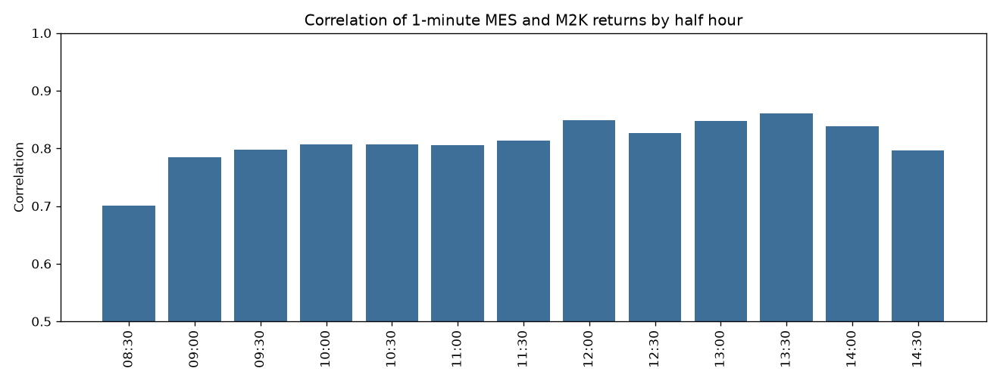

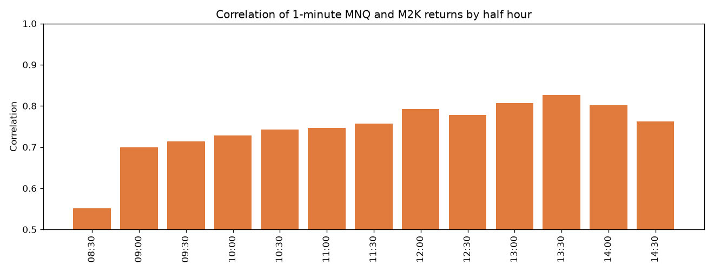

Lead-lag is the correlation of the MES (or MNQ) return ending at minute t with the M2K return ending at t+k. A positive lag is M2K's later minute. Lag 0 is 0.791 against MES and 0.716 against MNQ. Lag +1 is 0.028 in both pairs. Lag −1 is 0.010 against MES and 0.013 against MNQ. Russell does not lead either index by a minute. The other index is a hair earlier, and a hair of 0.03 correlation is not a trade.

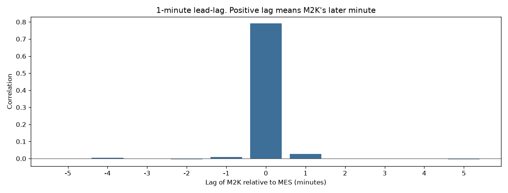

Four predictors were written down before they were scored. They are not part of the 63 and not part of the Sunday menu. N would have been 4. None of them made money in train, so none was a candidate, none was held out, and none has a p-value. The associations below are descriptive. They are not a second menu.

| question | full-sample correlation | the traded rule | train $/trade | val $/trade |
|---|---:|---|---:|---:|
| M2K overnight outperformance vs the MES first hour | 0.050 | buy or sell MES at 8:30 in that direction, 15bp stop, flat 9:30 | −$11.61 (638) | −$16.03 (282) |
| Prior-day VIX change vs the MES first hour | −0.013 | MES first-hour momentum only if VIX rose at least 1 point | −$12.08 (142) | −$24.70 (24) |
| Prior-day 10-year yield change vs the MNQ first hour | 0.016 | buy MNQ if yields fell 5bp, sell if they rose 5bp, flat 9:30 | −$6.70 (431) | −$10.08 (132) |
| M2K/MES first-hour divergence, fade MES | — | opposite signs, each at least 15bp, fade MES | −$85.66 (75) | $54.22 (24) |

The divergence fade's validation profit is 24 trades after a train loss of $86 a trade. It failed the train gate. It was not held out.

What actually matters is the ordinary comovement. Russell spends the cash day moving with the S&P, more loosely with the Nasdaq, and the open is the loose hour. That fact did not turn into a first-hour forecast. Yesterday's VIX change and yesterday's yield change are close to uncorrelated with the next first hour.

The yield series is the Treasury daily par yield curve, 10-year column, retrieved 2026-10-12 from home.treasury.gov. That is the series FRED publishes as DGS10. FRED returned HTTP 500. The rule uses the change between the two prints already published before the session. Today's yield is not in the signal. VIX is the Cboe daily close already used in the event section. The Cboe VIX-futures history file returned HTTP 403, so there is no intraday VX filter. No Databento key is present in this environment, so `metadata.get_cost` was not called and no ZN file was downloaded. A ZN 1-minute pull still needs that quote on the machine that holds the key before anyone spends the remaining credit.

## Sunday evening reopen

Topstep's hours page, read 2026-10-12, opens trading at 5:00 PM CT on Sunday and requires the book to be flat by 3:10 PM CT each weekday. Friday stays closed until that Sunday open. The page does not print the sentence "Sunday P&L counts as Monday." The window that starts Sunday at 5:00 PM CT ends Monday at 3:10 PM CT, and the CME trade date for that window is Monday. This study puts each Sunday evening on that Monday for the split. The four rules flatten earlier than the Topstep deadline: the gap rules at Monday 8:30 CT, and the evening rules at 21:00 CT Sunday.

Each market has 383 Sunday reopens in the file. One, the first Sunday, has no Friday close yet. None of the other weekends changed the contract string between Friday's cash close and the Sunday print, so no gap trade was dropped for a roll. Gaps smaller than 4 ticks were not traded and are not in the fill rates.

The typical weekend gap is small. The median absolute gap is 5.75 points on MES (0.13%), 17.6 points on MNQ (0.13%), and 3.0 points on M2K (0.15%). The median signed gap is about a point. The mean is negative because the left tail is fat: the 10th percentile on MES is −25 points.

| market | filled within 1 hour | 2 hours | 4 hours | by Monday 8:30 |
|---|---:|---:|---:|---:|
| MES | 37% of 343 | 43% | 49% | 65% |
| MNQ | 46% of 364 | 51% | 58% | 71% |
| M2K | 45% of 349 | 49% | 55% | 71% |

About half of the gaps that are large enough to trade have not touched Friday's close four hours after the reopen. About two thirds have touched it by the cash open. That is a slow fill, not a reliable evening trade. The extensions are what a fade has to survive.

Sunday's first hour is busier than a normal weekday evening and much quieter than the cash open. Median MES volume from 17:00 to 18:00 CT is 13,157 on Sunday and 6,718 on Monday–Thursday evening, against 189,780 in the cash first hour. The Sunday first-hour median range is 13 points on MES, 56 on MNQ, and 8.5 on M2K, about half the cash first hour (23, 122, and 19.6).

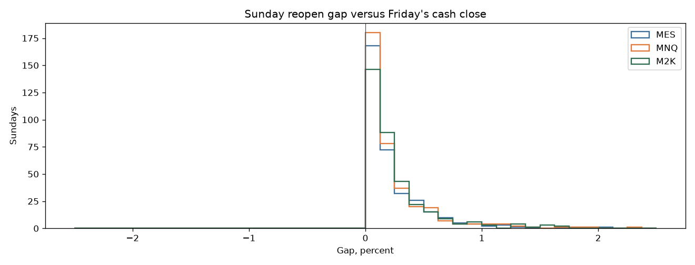

Four rules, three markets, N = 12 if any of them had qualified. None made money in both train and validation. The holdout was not opened.

| rule | market | train n | train $/trade | val n | val $/trade |
|---|---|---:|---:|---:|---:|
| sun_gap_fade | MES | 174 | −$53.05 | 53 | −$28.98 |
| sun_gap_fade | MNQ | 181 | −$44.17 | 50 | $9.84 |
| sun_gap_fade | M2K | 167 | −$40.07 | 59 | −$50.41 |
| sun_gap_go | MES | 170 | −$10.60 | 52 | −$13.19 |
| sun_gap_go | MNQ | 175 | −$4.69 | 50 | −$1.89 |
| sun_gap_go | M2K | 163 | −$30.37 | 58 | $22.94 |
| sun_orb30 | MES | 197 | −$1.91 | 64 | −$20.70 |
| sun_orb30 | MNQ | 188 | $5.35 | 58 | −$11.76 |
| sun_orb30 | M2K | 197 | −$3.54 | 65 | −$15.88 |
| sun_fade_hour | MES | 107 | −$66.99 | 35 | −$70.81 |
| sun_fade_hour | MNQ | 113 | −$52.13 | 38 | −$52.63 |
| sun_fade_hour | M2K | 106 | −$20.82 | 33 | −$24.20 |

The two cells that made money in validation, MNQ's gap fade and M2K's gap continuation, lost money in train. MNQ's 30-minute Sunday breakout made $5.35 a trade in train and lost $11.76 in validation. Fading the first-hour extreme lost about $20 to $70 a trade in every window that was scored. A high win rate does show up on the continuation rule (MES train 58%, M2K validation 69%) and the expectancy is still negative where the train gate applies, because the losses are larger than the wins once the fee and the slippage are in. These four rules do not support the idea that the Sunday reopen is a profitable trade for this account. A different Sunday method was not tested after seeing this.

## Recommendation after M2K, the predictors, and Sunday

Do not change the live bot. Do not add M2K. Do not filter MES or MNQ with Russell, with the prior VIX change, or with the prior day's yield change. Do not trade the Sunday reopen with a gap fade, a gap continuation, a 30-minute breakout, or a fade of the first-hour extreme. The M2K menu produced no finalist, so its holdout stayed shut. The four predictors and the twelve Sunday books failed the money gate before a p-value was computed. Leave the live settings where they are.

## What this study did not change

Live defaults are untouched: the 2-tick retest, the $1.40 fee placeholder, the $200 risk, the 2-contract cap, the morning window, and the flatten times. Research limit fills are stricter than the paper broker. The paper broker fills a target when price touches it. This study fills a limit only when price trades through it. Stops still fill on a touch, and if a stop and a target are in the same bar the stop wins. The research sizer is also separate. It can use up to 50 MES, or 50 MNQ when the study is priced as MNQ, and it charges both sides of slippage up front. It does not call the live sizer, which is capped at 2 MES.

